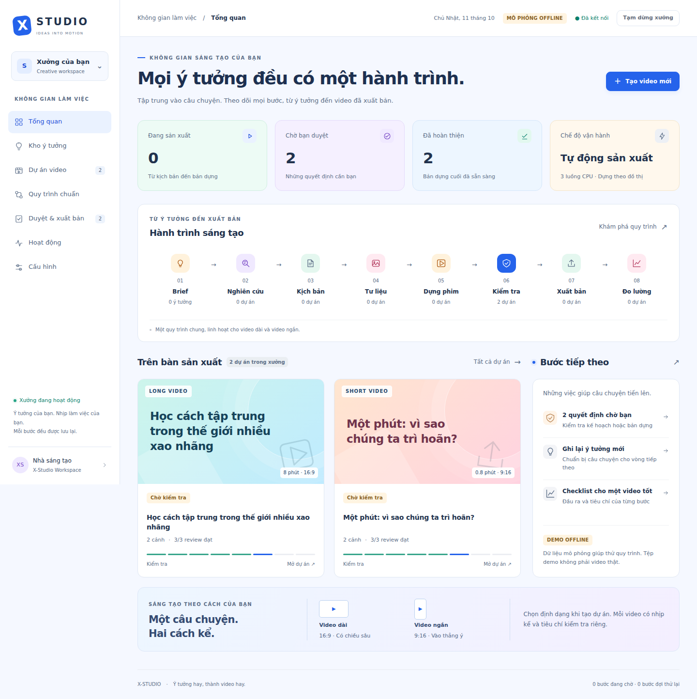

# X-Studio · Xưởng sản xuất video

Từ chủ đề đến kịch bản, lời đọc, hình ảnh/footage, dựng phim, phụ đề, kiểm tra và xuất bản YouTube. Một bảng điều khiển tiếng Việt, một worker, một database SQLite; tiếp tục công việc đã lưu sau khi khởi động lại.



## Chạy xưởng

Cần Python 3.11+, [uv](https://docs.astral.sh/uv/) và FFmpeg/ffprobe có libx264, libass, drawtext cùng font Unicode (Linux: `ffmpeg fonts-dejavu-core`). Không cần Node, Redis hoặc GPU cho bảng điều khiển và bộ dựng mặc định.

```bash
uv sync --all-packages --locked
make studio-demo
```

Mở `http://127.0.0.1:8765`, nhập mã truy cập trong terminal, chọn **Tạo video mới**. Demo có DB riêng `demo.sqlite`, model/media/nền tảng giả; tệp MP4 demo không phải video thật. Các test FFmpeg riêng vẫn dựng video thật từ fixture cục bộ.

Vận hành với cấu hình hiện có:

```bash
make studio
# hoặc chọn hồ sơ, DB và cổng
uv run python -m studio.console --media media.yaml --db studio.sqlite --port 8765
```

Giữ `llm.yaml` và cấu hình provider TTS/ảnh của bạn; tham khảo [media.example.yaml](media.example.yaml) và ghép các block `video`, `render`, `production` từ [media.factory.yaml](media.factory.yaml). Hồ sơ factory mặc định provider giả để không tự phát sinh phí khi sao chép. API key dùng biến môi trường/`api_key_env`, không nhập vào source hoặc giao diện. Adapter hiện có hỗ trợ nhiều provider và TTS cục bộ qua lệnh không shell.

Trong **Cấu hình xưởng**, chọn phong cách hình ảnh, số luồng CPU, burn-in phụ đề và chế độ:

| Chế độ | Hành vi |
|---|---|
| `manual` | Chờ người duyệt kế hoạch và xuất bản |
| `production` | Tự duyệt kế hoạch hợp lệ, sản xuất đến bản cuối, chờ duyệt đăng |
| `publish` | Tự sản xuất và duyệt đăng khi review, bản quyền, metadata và QC đều đạt |

`publish` cần kết nối YouTube thật, provider thật và đủ quyền tài khoản. Fake media luôn bị giữ lại. Nếu có allowlist người duyệt, thêm `policy:studio` cho tự động và `human:editor` cho console. Reply và escalation vẫn cần con người quyết định. Tạm dừng xưởng có hiệu lực sau bước đang chạy.

```bash
uv run python -m studio.youtube login
uv run python -m studio.youtube status
```

Chọn `platform.provider: youtube` trong `media.yaml` sau khi hoàn tất OAuth của tài khoản bạn. Không chạy hai orchestrator trên cùng DB. Khi chạy VPS, giữ loopback và mở qua SSH tunnel; console không được thiết kế để public trực tiếp ra Internet.

## Những gì đã được nâng cấp

- **UI/UX:** tổng quan với việc cần làm tiếp theo, kho ý tưởng có lưu/khôi phục, dự án dạng thẻ hoặc Kanban, tìm kiếm/lọc, brief video dài/ngắn, đọc kịch bản và nguồn, phòng dựng theo cảnh, xem/tải bản cuối/SRT, checklist duyệt và số liệu đã đồng bộ; responsive và không phụ thuộc CDN. Kho ý tưởng lưu trên trình duyệt; dự án sản xuất lưu trong SQLite.
- **Quy trình chuẩn:** [playbook tám bước](docs/QUY-TRINH-SAN-XUAT-VIDEO.md) với đầu ra, vai phụ trách và tiêu chí kiểm tra cho 16:9/9:16. Màn hình Quy trình chuẩn có hướng dẫn từng bước và nguồn GitHub tham khảo; các repo tham khảo không tự trở thành dependency.
- **Tiết kiệm gọi API:** TTS, ảnh, thumbnail có cache theo nội dung/cấu hình, checksum và commit nguyên tử. Nhật ký đầu ra render dùng lại event ID sau restart để tránh phát draft/editor lặp. Cảnh sửa có định danh riêng; lỗi giữa chừng không làm mất phần đã tạo thành công. Không tái sinh cảnh đã khóa khi file bị thiếu: báo lỗi để khôi phục đúng tài nguyên.
- **Video dài:** chia kịch bản theo chương, chia scene planning/fact review theo nhóm; ghi nhận token từng chương. Segment mới dùng FLAC lossless, concat đọc trực tiếp cache để tránh bản sao trung gian; decoder cũng bị giới hạn luồng. Bộ dựng `bounded` mã hóa một cảnh mỗi lần, tái sử dụng segment, ghép video bằng stream copy; `graph` cũ vẫn dùng được.
- **Hình và tiếng:** ảnh có chuyển động, footage video, catalog có giấy phép, nhạc duck dưới lời đọc, chuẩn hóa loudness, phụ đề chia trang và burn-in tùy chọn. Motion template title/quote/bars vẽ chữ Việt bằng code; biểu đồ bắt buộc có nguồn.
- **Độ tin cậy:** retry media có giới hạn/backoff, hàng lệnh SQLite, lease một worker, policy có chữ ký riêng và thế hệ gate; kiểm tra file/checksum, thời lượng, nguồn, mô tả CC-BY và QC trước tự xuất bản. Web research có cache TTL và allowlist tên miền vẫn kiểm redirect/SSRF.

Tư liệu local: đặt file của bạn dưới `output/uploads`, điền [examples/library.yaml](examples/library.yaml), rồi ánh xạ video/cảnh bằng [examples/production-selections.yaml](examples/production-selections.yaml). Chỉ khai quyền sử dụng mà bạn thực sự có. Credit CC-BY được thêm vào mô tả trước preflight. File thay thế qua cut-list chưa có hồ sơ quyền sử dụng được đánh dấu `unknown` để review chặn.

## Tạo phim và hoạt hình

Trong **Tạo video mới**, chọn **Phim ngắn** hoặc **Hoạt hình**, nhập tóm tắt câu chuyện,
hồ sơ nhân vật và phong cách (điện ảnh/2D/3D/anime). Định dạng 16:9/9:16 chọn độc lập.
Phong cách, character bible, negative prompt và seed được lưu trong brief/manifest;
phòng dựng hiển thị storyboard và cho xem/tải clip của từng cảnh.

- **Ảnh có chuyển động**: dựng theo pipeline TTS + ảnh + FFmpeg hiện có, phù hợp xem trước nhịp câu chuyện.
- **Clip AI**: sinh shot ngắn qua **ComfyUI** với workflow API-format đã cài, hoặc chương trình
  cục bộ qua `command`. FFmpeg lặp footage để phủ lời đọc và ghép bản cuối, phụ đề, nhạc.
  Chọn phong cách 3D là chỉ dẫn hình ảnh, chưa phải engine rig/animation Blender.

Ghép phần `scene_video` từ [media.film.example.yaml](media.film.example.yaml) vào cấu hình
đang dùng. Provider mặc định `none`; demo dùng `fake` và chỉ sinh tệp mô phỏng. ComfyUI
cần model/nodes/GPU phù hợp, graph xuất ở **API format**, bindings prompt/seed bắt buộc
và output node lưu **MP4**. `num_frames` cho phép khai số frame phù hợp model, chẳng hạn
81 với workflow yêu cầu 4n+1. `scene_video` sinh shot; `video.provider=ffmpeg` ghép phim.
Không cần thêm dependency Python cho adapter ComfyUI.

Cache nhận diện graph và cấu hình; accepted job lưu `prompt_id` để tiếp tục sau timeout.
Sửa cảnh sinh lại dùng seed mới ổn định theo lượt sửa, giữ cảnh đã khóa; bản quyền của
clip mặc định `unknown` cho tới khi được khai đúng. Mô tả/seed giúp quản lý nhân vật,
chưa bảo đảm danh tính; v1 dùng một giọng kể, chưa tự upload reference hoặc lip-sync.
UI báo provider đã cấu hình, không xác nhận GPU/backend đang hoạt động.

Ví dụ brief: [film-brief.json](examples/film-brief.json). Đối chiếu ComfyUI, Wan,
HunyuanVideo, LTX, AnimateDiff, MoviePy, Blender và Storyboarder cùng license:
[nghiên cứu GitHub](docs/RESEARCH-FILM-ANIMATION.md), [ADR-0013](docs/adr/0013-film-animation-scene-generation.md).

## Thời lượng, tài nguyên và giới hạn thực tế

Console nhận mục tiêu **0–720 phút** (lớn hơn 0). [YouTube](https://support.google.com/youtube/answer/71673?hl=en) giới hạn 12 giờ hoặc 256 GB, tùy giới hạn đạt trước; trên 15 phút cần tài khoản đã xác minh. Đây là giới hạn thiết kế/đầu vào, **chưa có benchmark render và upload 12 giờ trong đợt nâng cấp này**.

- Bounded giảm độ lớn graph, không làm mất chi phí theo thời lượng. Bộ nhớ phụ thuộc một cảnh; cache âm thanh lossless và video trung gian vẫn cần ổ đĩa. Đã stress fixture tổng hợp 30 phút 24 giây ở 640×360, chưa đo 12 giờ hoặc phần trăm tiết kiệm trên máy chuẩn. Có thể đặt `render.segment_cache_max_bytes` để dọn segment cũ không dùng; `render.min_free_disk_bytes` mặc định 256 MiB. Đây là kiểm tra giữa các bước, không phải quota ổ đĩa; không dọn cache TTS/ảnh trả phí.
- Burn-in phụ đề cần thêm lượt encode cuối. Muốn tiết kiệm CPU, tắt burn-in, dùng SRT riêng. Subtitle timing theo tỷ lệ lời đọc trong cảnh, chưa phải forced alignment/karaoke từng từ.
- Với video nhiều giờ, điều chỉnh `render.timeout_s` và `STUDIO_QC_TIMEOUT_S` theo máy; mặc định QC 300 giây. Ví dụ đặt `STUDIO_QC_TIMEOUT_S=86400` trước khi khởi động worker. Không tắt timeout hoàn toàn.
- Ngân sách token là token model text, không phải trần tiền cho TTS/ảnh. Dừng trước chương tiếp theo khi đã hết; một request đang chạy có thể vượt phần còn lại. Chất lượng sáng tạo, tính đúng đắn nội dung và thời lượng thực phụ thuộc model/provider; QC giữ lại sản phẩm lệch mục tiêu quá 20% mặc định.
- Video diffusion chạy qua workflow ComfyUI cấu hình riêng; chưa cài/benchmark model GPU. Chưa tích hợp stock search tự tải, tracking người nói, editor timeline kéo thả hoặc render cluster. Xem [đối chiếu nguồn và quyết định tích hợp](docs/RESEARCH-VIDEO-FACTORIES.md).

## Phát triển và xác minh

```bash
make verify            # lint/typecheck + coverage cả 3 package + eval replay
make studio-demo       # kiểm tra workflow offline
```

CI Linux cài FFmpeg/font, khóa phiên bản GitHub Actions và chạy cùng lệnh. Coverage yêu cầu 100% dòng cho từng package. Test renderer thực kiểm tra footage, nhạc, phụ đề, frame timing, cache và retry; test HTTP kiểm tra auth, Origin/CSRF và byte-range. Các lỗi retry nhánh, resume sau lỗi render, QC chưa hoàn tất và HTTP range được chặn bằng regression test; xem [ADR-0011](docs/adr/0011-recovery-and-bounded-checkpoints.md) và [ADR-0012](docs/adr/0012-durable-render-outbox-and-disk-budgets.md). Kiểm tra UI desktop/mobile bằng Chromium được ghi tại [VALIDATION.md](docs/VALIDATION.md).

- `src/studio/`: factory, console, orchestration, render, QC, provider và YouTube adapter.
- `src/studio/web/`: HTML/CSS/JavaScript native, đóng gói cùng Python.
- `agents/`, `skills/`, `topics/`: 14 vai, 24 skill và schema sự kiện; giữ prompt hiện có.
- `gateway/`, `xagents-core/`: thành viên uv workspace có test/coverage riêng.
- `tests/`: pytest 947 ca / 64 file.
- Test: 947 ca pytest của studio; xem báo cáo xác minh cho kết quả thực tế.
- `docs/adr/`: ADR 0001–0014; [ADR-0010](docs/adr/0010-production-factory.md) giải thích kiến trúc factory, [ADR-0013](docs/adr/0013-film-animation-scene-generation.md) bổ sung phim/hoạt hình, [ADR-0014](docs/adr/0014-durable-youtube-upload-reconciliation.md) phục hồi upload YouTube.

Tham khảo thêm: [kiến trúc nền](docs/architecture.md), [CLI chi tiết](docs/CLI-REFERENCE.md), [CLAUDE.md](CLAUDE.md). Các hướng dẫn cũ về gate được bổ sung bởi policy ủy quyền ở ADR-0010.
